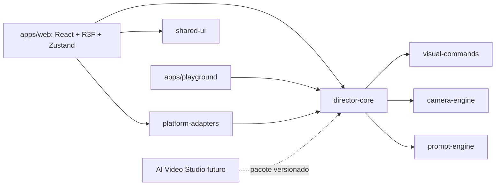

# Especificação técnica proposta — CS AI Director

**Data:** 25/11/2026

**Estado:** direção geral aprovada em 25/11/2026; implementação local em andamento. O catálogo e os detalhes sem fonte continuam provisórios.
**Fonte confirmada:** solicitações presentes nesta conversa. Os detalhes das conversas anteriores e os 20 exemplos do Instagram não estão disponíveis aqui. Tudo que não foi especificado pelo usuário aparece como **proposta**, sujeita a revisão.

## 1. Produto e escopo

Aplicativo web independente, em pt-BR, para compor direção cinematográfica de câmera em uma cena 3D, ajustar comandos parametrizados e transformar a direção em prompts claros para geração de vídeo. O núcleo deve ser consumível por outra aplicação sem depender da interface web, em especial pelo AI Video Studio no futuro.

### Objetivos da primeira entrega funcional proposta

1. Escolher um comando do catálogo, inspecionar sua explicação e ajustar seus parâmetros com unidades e limites explícitos.
2. Pré-visualizar uma trajetória reproduzível de câmera em um simulador 3D interativo, com controles de reprodução, pausa, reinício, tempo e enquadramento.
3. Organizar comandos em sequência na linha do tempo, validar conflitos e visualizar o resultado composto.
4. Gerar prompt estruturado em pt-BR, com tradução/adaptação por perfil de plataforma quando houver regras conhecidas; sempre oferecer modo genérico.
5. Salvar e reabrir projetos localmente por arquivo JSON versionado; exportar texto e copiar para a área de transferência.
6. Funcionar sem login e sem rede após o carregamento da aplicação, exceto por futura publicação opcional.

### Fora da primeira entrega

Geração de vídeo por IA, cobrança, conta de usuário, colaboração em tempo real, armazenamento em nuvem e automação do AI Video Studio. Esses itens exigem desenho e autorização próprios.

## 2. Abordagens consideradas

| Abordagem | Vantagem | Custo ou risco |
| --- | --- | --- |
| **A. Monorepo TypeScript com núcleo puro e aplicativo React (recomendada)** | Contratos e testes compartilhados, integração posterior por pacote e experiência 3D rica | Exige disciplina nas fronteiras dos pacotes |
| B. Aplicativo React único | Começo mais rápido | Extração posterior do núcleo e integração mais caras |
| C. Backend desde o início | Facilita persistência e colaboração remota | Complexidade, operação e custos sem necessidade para o fluxo inicial |

**Decisão aprovada:** A, com execução local no navegador e persistência por arquivo. A escolha de tecnologias foi usada na primeira implementação; contratos v1.0 seguem provisórios até as fontes serem conferidas.

## 3. Experiência do usuário

Fluxo principal: **catálogo → seleção → parâmetros → prévia 3D → linha do tempo → prompt → exportação**. A tela principal proposta tem catálogo pesquisável à esquerda; viewport e controles de reprodução ao centro; parâmetros e prompt à direita; linha do tempo abaixo. No celular, os painéis viram abas, mantendo controles operáveis. A interface deve indicar o comando ativo, estado de validação, duração e unidades. A prévia 3D é explicada por uma ficha textual de início/fim, direção e intensidade.

Estados necessários: projeto vazio com orientação de primeiro uso, carregando, pronto, parâmetro inválido, comando incompatível, falha de WebGL com alternativa textual, arquivo inválido e exportação concluída. Undo/redo para edições locais é proposto. Atalhos de teclado devem ser documentados; foco, contraste e redução de movimento devem respeitar preferências de acessibilidade.

## 4. Arquitetura modular

### Correspondência proposta com os nomes anteriores

**CS Visual Commands v1.0** designa o catálogo de intenções cinematográficas: identificadores, descrições, parâmetros, exemplos e regras de validação. A implementação ficaria em `visual-commands`, sem depender de Three.js. **CS Camera Director v1.0** designa o motor que transforma instâncias desses comandos em poses de câmera e sequências temporais; sua geometria ficaria em `camera-engine`, e composição/projeto em `director-core`. Essa divisão é uma proposta de interpretação dos nomes citados, não uma recuperação do conteúdo das discussões anteriores. Os contratos v1.0 só devem ser congelados após conferência das fontes.

| Módulo | Responsabilidade | Dependência permitida |
| --- | --- | --- |
| `visual-commands` | Catálogo versionado, metadados, parâmetros e validação | Tipos compartilhados mínimos |
| `camera-engine` | Sistema de coordenadas, trajetórias, interpolação, projeção e amostragem | Biblioteca matemática sem React |
| `prompt-engine` | Template, normalização, expansão e adaptação por perfil | Contratos de comandos e projeto |
| `director-core` | Modelo de projeto, timeline, composição, validação global e operações de serialização | Três motores acima |
| `platform-adapters` | Perfis de exportação, formato genérico e futuros conectores | `director-core`; sem importações reversas |
| `shared-ui` | Controles visuais e acessíveis | React, sem regras de domínio |
| `apps/web` | Orquestração de UX, estado de interface e renderização R3F/Three.js | Pacotes publicados do monorepo |
| `apps/playground` | Exemplos, experimentos e testes manuais de contratos | Pacotes do monorepo |

**Stack proposta:** React, TypeScript em modo estrito, Three.js, React Three Fiber, Zustand e Tailwind CSS; Vite para aplicativos; pnpm workspaces para o monorepo; Vitest para unidades, Playwright para fluxo web e verificações visuais seletivas. Versões exatas e lockfile serão definidos na implementação aprovada. Nenhuma dependência é necessária nesta fase documental.

### Contratos públicos propostos

`DirectorProjectV1` contém `schemaVersion: 1`, `id`, `title`, `scene`, `camera`, `timeline`, `promptPreferences` e `metadata`. `scene` guarda escala em metros, alvo e objetos de referência simples; não inclui mídia proprietária. `timeline` contém faixas com `CommandInstance` (`id`, `commandId`, `startSeconds`, `durationSeconds`, `params`, `enabled`). Cada comando possui `CommandDefinition` com ID estável, categoria, descrição pt-BR, `parameterSchema`, capacidades e função de trajetória ou de foco. A API pura deve oferecer operações equivalentes a `validateProject(project)`, `sampleCamera(project, timeSeconds)` e `renderPrompt(project, profileId)`, retornando resultados tipados e erros recuperáveis, nunca exceções por entrada de usuário inválida.

Projetos JSON devem ser validados na importação, rejeitar versões desconhecidas com mensagem clara e migrar versões antigas apenas por transformações explícitas e testadas. IDs não devem depender do texto traduzido. Exportadores recebem uma representação intermediária estruturada, não acesso ao estado React.

## 5. Regras de câmera e composição

O sistema mundial usa mão direita, `+Y` para cima e metros; câmera começa olhando para um alvo. Ângulos humanos em graus, convertidos para radianos nos cálculos. O tempo usa segundos e amostras por tempo absoluto, para que pausa, seek e exportação sejam determinísticos. A duração mínima proposta é 0,1 s. Curvas de aceleração têm perfis explícitos (`linear`, `easeInOut`) e nunca alteram o ponto final. Movimentos simultâneos são compostos em ordem estável: deslocamento do alvo/posição, orientação, projeção/zoom e foco. Comandos em faixas diferentes seguem prioridade temporal e regras de mistura documentadas em `comandos-e-parametros.md`. A prévia deve mostrar guias para eixo, alvo e trajetória; renderização não é fonte de verdade para o motor.

## 6. Motor de prompts

Pipeline proposto: validar projeto → resolver comandos e parâmetros → criar descrição semântica intermediária → expandir contexto de cena, movimento, duração e enquadramento → adaptar por perfil de plataforma → renderizar texto. O modo genérico não depende de APIs. O motor não deve inventar objetos, emoções, modelo de câmera ou características que o usuário não forneceu; sugestões opcionais devem ser identificadas como tal. Perfis específicos precisam de regras versionadas e exemplos aprovados. A saída deve informar advertências quando uma plataforma não expressar um parâmetro. Mesmo projeto, mesma versão de regras e mesmo perfil produzem a mesma saída.

## 7. Persistência, segurança e desempenho

Dados locais por arquivo JSON; autosave no navegador pode ser avaliado após teste de privacidade e recuperação. Não enviar prompts ou projetos a servidores por padrão. Sanitizar nomes de arquivos e texto exibido; limitar tamanho de importação; não executar conteúdo de arquivos. Uma cena de referência leve, geometria simples, limite de pixel ratio e opção de qualidade reduzem custo de GPU. O fluxo básico deve permanecer utilizável sem WebGL via formulário, resumo textual e geração de prompt. Medir tempo de abertura, interação e seek em hardware alvo antes de fixar metas numéricas.

## 8. Integrações futuras

- **GitHub:** repositório fonte, CI para tipos, testes, build e revisão; versionamento semântico dos pacotes; publicação apenas com autorização. Não depender de GitHub em runtime.
- **Vercel:** possível hospedagem da interface estática, com variáveis não secretas e prévias de PR; avaliar domínio, orçamento e política de deploy antes de ativar. Nenhum deploy automático nesta etapa.
- **AI Video Studio:** consumir versões publicadas de `director-core`, `visual-commands`, `camera-engine` e `prompt-engine` por pacote; negociar contrato de projeto, perfis de exportação e política de versões. Integração por adaptador, sem editar o projeto existente nesta etapa.

## 9. Diferenciais comerciais possíveis

Prévia 3D antes da geração de vídeo; comandos com parâmetros consistentes e explicação visual; prompts reprodutíveis e auditáveis; adaptação transparente entre plataformas; operação local com privacidade; núcleo licenciável e integrável. São hipóteses de posicionamento, a validar com usuários e análise de concorrentes, não promessas de desempenho ou compatibilidade.

## 10. Decisões pendentes para aprovação

1. Confirmar a abordagem A e o escopo da primeira entrega.
2. Fornecer ou validar os registros de CS Visual Commands v1.0, CS Camera Director v1.0, os 20 comandos do Instagram e comandos parametrizados. A lista atual é proposta, não reconstrução histórica.
3. Confirmar semântica de movimentos simultâneos, limites de parâmetros e formato de prompt desejado.
4. Definir cena de referência e plataformas de vídeo prioritárias para perfis futuros.

Critérios por módulo e etapas estão em `roadmap.md`. Comandos e regras detalhadas estão em `comandos-e-parametros.md`.
